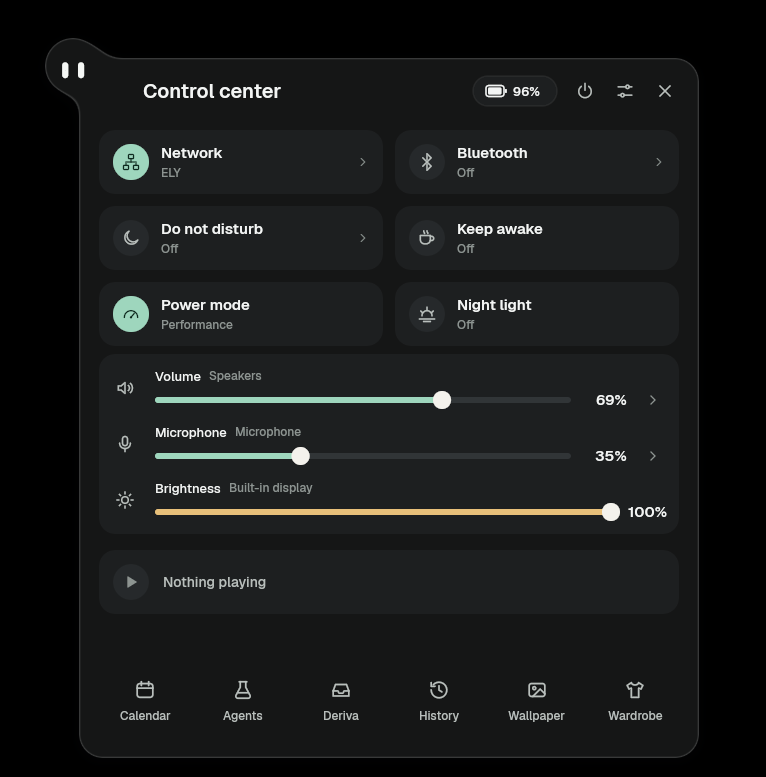
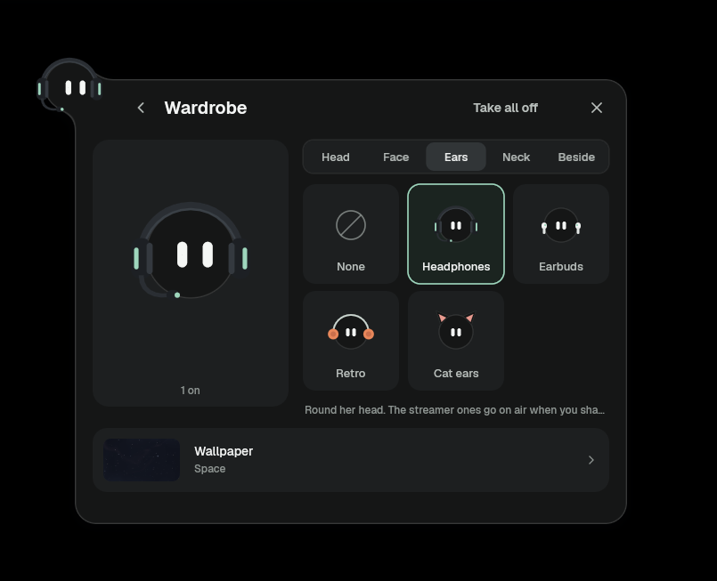
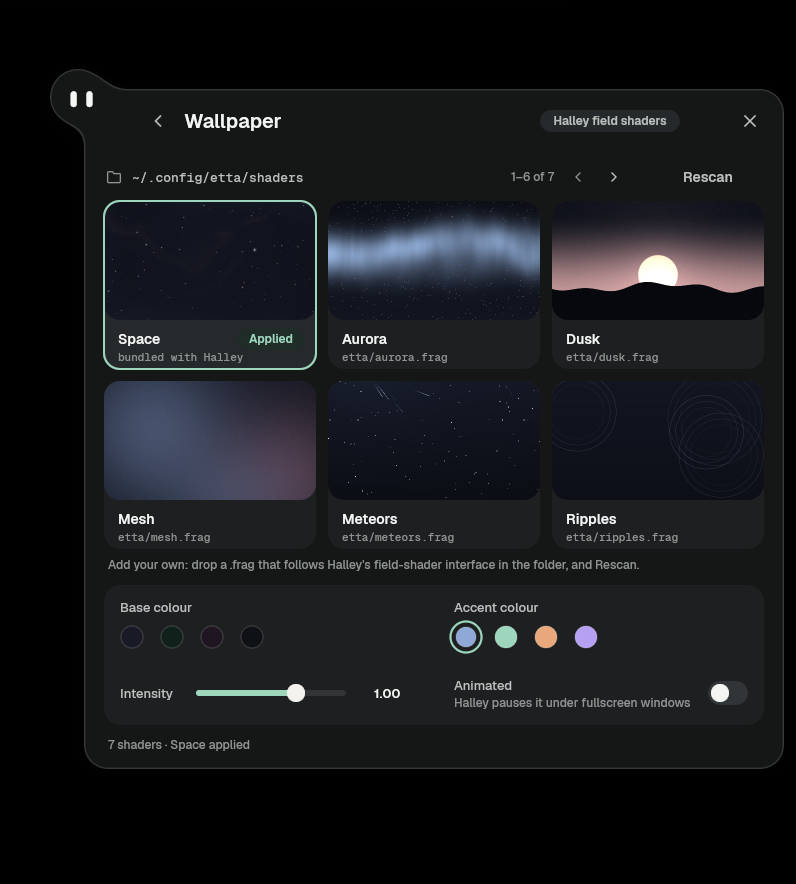
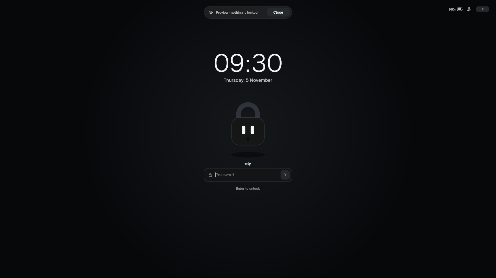

<h1 align="center">Etta</h1>

<p align="center"><em>A small companion for the Halley desktop.</em></p>

Etta is a desktop companion for the [Halley](https://github.com/saltnpepper97/halley)
compositor: a little ball with a face that lives at the top of your screen and
is your whole shell — clock and battery, notifications, control center, finder,
captures and recordings, lock screen. She is written in
[pleamar](https://github.com/k4ditano/pleamar).

<p align="center">
  
  
</p>
<p align="center">
  
  
</p>

Her name comes from Halley's comet: the trail of debris 1P/Halley leaves behind
gives the Eta Aquariids meteor shower. From *Eta*, Etta — the small character
that lives alongside Halley.

Etta began as [Marea](https://github.com/k4ditano/marea-plm), by Abel. See
[`NOTICE.md`](NOTICE.md) for what she keeps from Marea and what is new.

## Run her

```sh
git clone https://github.com/ely-id/etta ~/Work/etta
~/Work/etta/etta start            # her log goes to ~/.local/state/etta/etta.log
```

She needs pleamar 0.2.8 or newer on the `PATH`. On Halley she builds her small
adapter (`halley/`) the first time she starts, if `cargo` is installed.

In `halley.rune`:

```rune
autostart:
  once "/home/YOU/Work/etta/etta start"
end

keybinds:
  "$var.mod+space" "/home/YOU/Work/etta/etta search"
  "$var.mod+shift+l" "/home/YOU/Work/etta/etta lock"
  "$var.mod+shift+s" "/home/YOU/Work/etta/etta shot_region"
  "$var.mod+shift+v" "/home/YOU/Work/etta/etta record_toggle"
  "$var.mod+shift+p" "/home/YOU/Work/etta/etta pick_color"
end
```

For her Tailscale pill to send and receive files, your user has to be
Tailscale's operator, once: `sudo tailscale set --operator=$USER`. What
arrives goes to `~/Downloads/Taildrop`.

## Talk to her

```sh
etta start | stop | status | report
etta search | lock | shot_region | shot_screen | shot_window | record_toggle | pick_color
etta volume_up | volume_down | mute_output | mute_mic | bright_up | bright_down
```

Click her for the control center, right-click for her menu. The pill beside
the clock is Tailscale: your devices, their addresses, and files sent to them
by dropping them on their row. A colour picked (her menu, the finder or
Super+Shift+P) goes to the clipboard and to a little her who keeps them. Her settings are
saved in `~/.local/share/pleamar/etta/settings.json`.

## How she is made

One scene (`etta.plm`) and its logic (`etta.luau`); the design tokens and the
pieces every panel is built from (`ui/`); her wardrobe (`wardrobe/`); her
shaders (`shaders/`); wallpaper shaders for Halley (`wallpapers/`); the Halley
adapter (`halley/`) and Deriva's library (`deriva/`).

## License

BSD 3-Clause, keeping Marea's notice. The Halley adapter executable is
GPL-3.0-only. Details in [`NOTICE.md`](NOTICE.md).
