# Marea, gesture by gesture

What the contract (`proyecto-marea/docs/ANIMACIONES.md`) asks for, and what this
version does. Nothing is accepted by eye: every duration is measured with
`pleamar --registrar`, which records the value of every property **on every
frame**.

```sh
pleamar --escena bolita.plm --segundos 38 --sin-hud --registrar lid,body.y,tilt > reposo.tsv
```

## Lively idle

| Contract requirement | Implementation | Measured |
| --- | --- | --- |
| Brief blink every 5.2 s | `blink lid every 5.2s for 120ms` | Exactly 5.20 s between blinks |
| Gaze follows the mouse | `look gaze.x, gaze.y … reach 6, 3.5 within 260` | Responds while the logic is stopped |
| Breathing every 12–24 s | `every 12s..24s { play breathe }` | At 17.0 s and 36.1 s |
| Lasts 1.3 s | Five-frame gesture: 220 + 320 + 180 + 200 + 380 ms | 1.30 s |
| Eyes look **before** rising | First frame, `look.y: -1.2` | Yes |
| Body rises **2 px** | `body.y: -2` | Exactly −2.00 px |
| Blinks fully while at the top | Frames 3 and 4, `lid: 0` → `lid: 1` | Body stays at the top for 733 ms |
| Settles with minimal asymmetry | `380ms out_back { tilt: 0.012 }` | Peak of 0.0132 rad |
| **Returns exactly to neutral** | They are `pose`s: anything a gesture does not name returns to its base | Returns to 0 |
| Blinking is suspended during a gesture | A gesture takes precedence over ambient behavior and pauses its timer | 5.20 + 1.30 around the breath |

## Hidden mode: the edge and the meniscus

| Contract requirement | Implementation | Measured |
| --- | --- | --- |
| Submerged, with slightly less than half visible | **Not here**: with “slightly less than half,” the top edge of the eye fell 1.25 px above the screen edge and the eye was visibly clipped. Almost two-thirds is visible, and the eyes are lowered 4.5 inside the face | 29 of 46 px visible |
| Travel lasts 620 ms | `prop out = 0 ~620ms` | 619 ms on exit, 613 on return |
| Sinks again after 2.6 s of grace | `on away cuerpo_zona for 2.6s { needed = false }` | The trigger is the contract itself, written exactly as specified |
| The join is not a translation but **surface tension** | The edge water and the little ball are **one silhouette**, merged with `blend` | See `evidencia/menisco-a-mitad.png` |
| **Concave** neck, wide at contact and narrowing to a thread | It comes from merging the two shapes: nobody draws the neck | See `evidencia/menisco-secuencia.png` |
| Breaks apart when separation exceeds its own size | The merge turns itself off: `30 * 4 * out * (1 - out)` | Breaks near the end |
| Fillet is smallest at rest and largest halfway | Exactly that bell curve | Yes |

### She is the drop

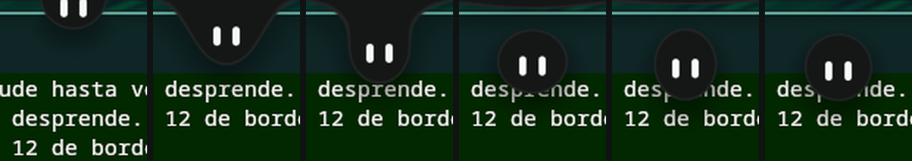

Submerged, hanging by the neck, about to break, just released, bouncing, and at
rest.

When looking at it on screen, two things were missing that the numbers do not
tell you. **You could not see her eyes**: when submerged, her center is almost
on the surface, so eyes centered on it end up with their tops clipped by the
edge, leaving two little lines. They are lowered inside the face—5.75 here,
compared with Marea's 7 out of 56—and are fully visible without showing more of
her, since the point is for her to stay in the edge.

And **it did not look like water; it looked like a curtain with a hole**. The
meniscus was fine, but everything else was rigid. Now:

| | |
| --- | --- |
| She **stretches** while hanging | The surface pulls and narrows her: +11% halfway through the journey, and +17.6% as it pulls her back in |
| She **shakes** as she is released | −7.3% squashed · +5.2% elongated · −1.2% · round. Three bounces in 400 ms, with her own lightly damped spring (`spring chapoteo = 420, 13`) |
| The surface **jerks** | The bulge around her snaps away and rebounds: `impulse rebote -150` |
| **A drop** remains hanging | The water swallows it in 520 ms |
| A **ripple** appears on each side | It travels across the sheet while shrinking, over 500 ms |

The first effect is what is really visible: 46 px moving, not 12 px of edge.
The ripple and drop are there, but the screen edge leaves only twelve pixels of
space, so not much else fits.

**This piece did not require language changes.** One declared spring, two
impulses, and four more shapes in the same `body`.

**And more of her is visible than the contract specifies.** “Slightly less than
half” leaves her center 3 px above the edge, and with the eyes 2.5 below the
center, the top edge of the eye falls **above the screen edge**: the bottom of
the eye is visibly clipped, the first thing you notice when you look at her.
29 of 46 px are visible, and you can see her face. This is a deliberate
deviation, documented in the scene.

**What this saves.** In QtQuick, the meniscus is `prototype/Meniscus.qml`: 162
lines calculating two Bézier curves, their control points, the angle where they
attach to the ball, and the intersection with the surface, plus comments
explaining why each curve bends inward rather than outward. Here it is two
shapes in the same `body` and a number that rises and falls. The neck is not
drawn: it appears.

## Opening and closing

| Contract requirement | Implementation | Measured |
| --- | --- | --- |
| 290 ms to open | `card: 1 ~290ms` | 283 ms |
| Content enters behind it | `content: 1 ~200ms after 90ms` | Starts 102 ms later and lasts 198 ms |
| On close, **content first**: 50 ms | `content: 0 ~50ms` | Disappears in 50 ms, three frames |
| **Then** the geometry: 210 ms | `card: 0 ~210ms after 50ms` | Starts once the content is gone and takes 210 ms |
| Moves aside to present the card | `let cx = 120 + (1 - card) * 240` | Moves with the opening itself |
| Click opens it; hovering **does not** | `on press cuerpo_zona { toggle open }` | Moving close does not open anything |
| Closes on exit, with 320 ms grace | `on away conjunto for 320ms { open = false }` | The group includes the ball, bridge, and card |

The reverse order between opening and closing is written as two rules and reads
like the contract:

```
on change open while open      { card: 1 ~290ms;  content: 1 ~200ms after 90ms }
on change open while not open  { content: 0 ~50ms; card: 0 ~210ms after 50ms }
```

**Two things that showed up when looking at it, but not in the numbers:** the
card extended below the surface, and the audio block overlapped the sliders.
The second was my mockup; the first is because **a surface does not grow to fit
what it contains, not even to fit a shadow**: the card needs 62 px below it (18
of offset and 44 of blur), and without that it is abruptly cut off at the edge.

Declaring the surface manually is not specific to pleamar: Marea also declares
it, and its height was manually increased three times—520, 640, 880—with a note
in `core/Theme.qml` saying the symptom did not point there at all. What was
specific to pleamar was that it said nothing. Now it reports it:

```
render · a shadow is cut: it needs 30 px below more than this 760 x 520 surface has.
         The shape fits; its shadow does not
```

Once, when the scene settles—not at the first pixel, which would be the wrong
time for an opening card—and only if the shape floats away from that edge: a
bar attached to the top has its shadow clipped at the top intentionally. This
is the second time that building Marea with pleamar has resulted in pleamar
itself, not just the mockup.

**This piece did not require language changes.** With `on change` and `while`,
transition delays, and springs specified by duration, the choreography came
out exactly as written in the contract. The card is in
`evidencia/centro-de-control.png`, beside its design
(`design/concepts/2026-08-31-centro-y-apps`).

## The level on her face

> “Both eyes lie down and join into a single centered bar, the same
> thickness as their width: it is the same pill rotated 90°. That bar is the
> track of a normal volume bar, filling with mint from left to right; the
> percentage appears on her forehead. 180 ms to enter, stays for 1.1 s after
> the last change, then restores her face. Triggered by the panel slider **and
> the keyboard volume key**. Gray when muted.”

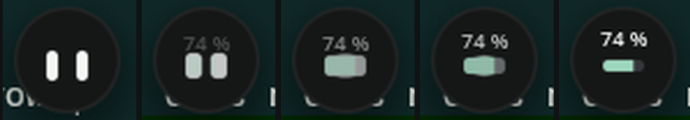

From left to right, the same face with `meter` at 0, ¼, ½, ¾, and 1.

| Contract requirement | Measured |
| --- | --- |
| The same pill rotated 90° | The eye is 5 × 13; lying down, 13 × 5. No new shape is created |
| A single centered bar | Centers move from ±6.5 to ±2.5. Total travel is **18 upright and 18 lying down**: the eyes only widen and slide; nothing jumps |
| No visible seam | They overlap by 8, and the two rounded ends add up to 5: the join stays hidden |
| 180 ms to enter | Spring `~180ms`. Measured: 0 → 1 in 190 ms, with an imperceptible 3% overshoot |
| Stays for 1.1 s after the **last** change | Measured with three consecutive changes to the real volume: returns 1,102 ms after the third, not the first |
| Fills with mint from left to right | Yes, and it is **the same track painted again and clipped on the left**: the mint has the exact shape of the bar, including its ends, with no extra geometry |
| Percentage on her forehead | `number(volume * 100, 0, " %")`, which rises 3 px as it appears |
| Gray when muted | `mix(mint, #6b7280, muted)` |
| Slider and key behave the same | Not one line of logic: `service audio { volume: number; muted: bool }`. Verified by changing system volume with `wpctl`, just as the key does |

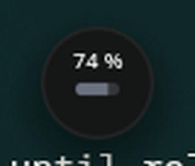

**What pleamar does better here, and QML could not accommodate.** The eyes do
not overlap: **they merge**. Before they touch, a bridge forms between them,
just like between the ball and the edge, because they are one `body`, not two
boxes. It is a bell curve like the meniscus—they touch exactly halfway through
the journey, where it is fullest, and nothing remains at the ends—so upright
they are two clean eyes, and lying down they make a bar without a waist. In
QML, two approaching `Rectangle`s simply overlap; this would require drawing a
third shape that no one sees.

**What it costs.** The entire episode—rise, hold for 1.1 s, and return—takes
92 frames, and **the renderer sleeps for 683 ms of that 1.1 s**: as soon as the
spring settles it stops drawing, and the waiting rule does not poll; it
schedules a wake-up.

## The countdown, the camera, and the red dot

> **Recording.** “The countdown happens INSIDE the little ball: her eyes
> become the number, with a decreasing bounce each second… the left eye becomes
> a red dot and follows the pointer. The red dot lights up when the recorder is
> running, not when clicked: it is a statement about the present.”
>
> **Screenshot.** “…she returns with her eyes turned into a camera.”

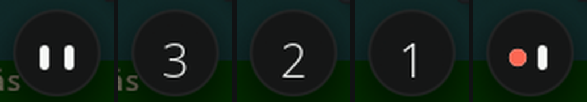

And the camera with its shutter, and the dot before and after the recorder
actually starts:

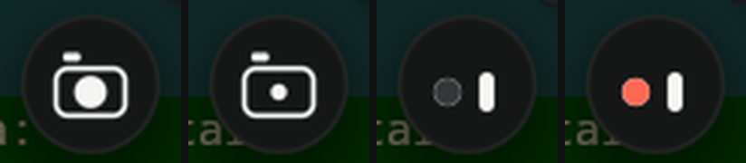

### How it is written

All of this is **a single chain**: the usual eye, pulled by each state in turn.
There are no shapes being swapped or per-state animations fighting over the
same eyes; there are five springs following a typed fact
(`fact face: eye | count | camera | rec`), and the geometry bends until it
becomes something else. Any state can therefore interrupt another halfway
through, and all you see is the shape changing its mind.

| Contract requirement | Measured |
| --- | --- |
| Three numbers, one per second | 1,000 ms, 1,000 ms, 1,000 ms |
| **Decreasing** bounce each second | Scale 1.25 · 1.17 · 1.08. It is a shove to the spring's velocity (`impulse pop left * 2.5`), not an animation toward a size: each hit starts where the previous one left off |
| “The last one lands just as recording starts” | From the last number to the dot: **17 ms**, one frame |
| Zero is not shown | The number is `max(left, 1)`: zero is not a countdown value; it is the moment to start |
| Dot lights up when recording starts, not on click | Two separate things: `dot` is the disk (follows `face == rec`) and `red` is the red color (follows `taping`). First the eye becomes a dark disk; red appears once the recorder is running |
| The right eye remains an eye | Yes, and it follows the pointer: that keeps her alive while it lasts |
| Eyes turned into a camera | The left opens into the lens (13 from the design, 5 with the shutter) and the right stretches into the body (30 × 21, corner radius 6). The viewfinder is a separate mark because there are no eyes left |

### The two things here that come from pleamar, not QML

**The number comes out of the eyes.** Both move to the center and merge into a
drop—they really merge, because they are one body—and the drop **opens like a
diaphragm**: it grows while its center is eaten away, leaving a ring with the
number inside.


**A hole is just another shape.** Neither the diaphragm nor the camera body is
drawn with a border: its center is eaten away by a shape the color of the
little ball. Everything here is based on distances, so a hole is not a special
case. In QML, the camera body is a `Rectangle` with `border` and a transparent
background; the diaphragm does not exist, because a white number merging over
a white drop turns gray and cloudy.

## The screenshot and the recording corner

> **Screenshot.** “Anticipates for 70 ms, stretches, and exits through the top
> edge in 150 ms; then she hides, the screen is frozen, and she returns with
> her eyes turned into a camera.”
>
> **Recording.** “The countdown already starts from the corner she will occupy.
> Then she moves into a screen corner, with 82% of her visible… Her gaze folds
> toward the visible side.”

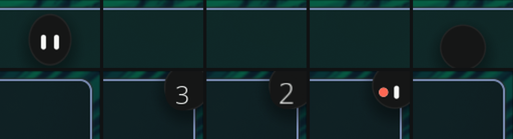

Above, her usual place; below, the screen corner, which is **another surface**.
From left to right: she stretches to leave, is gone and counts down from the
corner, records, and returns.

| Contract requirement | Measured |
| --- | --- |
| Anticipates for 70 ms | Drops 3.3 px and stretches to 0.94 × 1.12 in 70 ms |
| Exits through the top in 150 ms | She is out of frame 220 ms after the event |
| Changes face where nobody can see | `cam` changes from 0 to 1 while she is outside the surface |
| 200 ms pause | 220 ms before she returns |
| Returns as a camera | Falls on a live spring and lands 3 px past the target: she returns; she does not “appear” |
| Shutter: closes in 80, opens in 170 | A gesture on the `shut` pose, with a body kick (1.05 × 0.95) that Marea does not have |
| 82% visible | Center 14.7 px from the corner: 46 × 0.82 − 23 |
| Countdown from the corner | Countdown starts when she reaches the top, with her already entering from the corner |
| Gaze folds | `min(gaze.x, 0)`, `max(gaze.y, 0)`: she never looks toward her hidden half |
| Clicking her stops it | Stopping halfway through the countdown returns her with her eyes, not recording |

**She travels along the edges.** Marea hides one window and shows another.
Here, she actually exits through the top—with the same gesture for screenshots
and recording—and actually enters through the corner, settling against it with
a bounce. Her face is a `component`, so it is the same in both places, with the
same springs. And the corner surface stays open while any part of her remains
inside (`open: tuck > 0.01`), so when recording stops she slides out instead
of disappearing with the window.

### Moving close brings out the timer and “Stop”

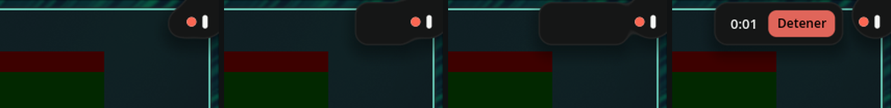

In Marea it is a rectangle that fades in beside her over 150 ms. Here it
**emerges from her**: it is the same body, stretching inward like a drop,
forming a neck halfway through, and separating until it is 8 px away. The
content enters late, once the panel has detached—before, the button ended up
under her face. It folds away with 320 ms of grace, because the gap between
her and the panel is real and cannot be lost while crossing it.

The renderer counts the timer (`every 1s while taping`), and a new pleamar
feature formats it: `{secs, time}` → `0:07`. Verified with the simulated
mouse: moving close brings it out, hovering lights up the button, and clicking
“Stop” returns her to the top.

### The four corners

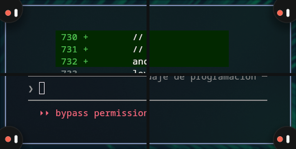

The contract says that the corner **is chosen so it falls outside the
recording**. The logic knows what is being recorded, so the scene only follows
its instruction: a typed fact, `fact rincon: top_right | top_left | bottom_right | bottom_left`,
and the surface attaches to that edge. It can change **while running** without
recreating anything: this was missing from pleamar and is now provided by
`anchor: rincon`.

Everything attached to her follows the corner: the angle from which she enters
and exits, the direction her gaze folds, and the side from which the timer
panel emerges—always inward, never out of the screen.

| | Her center | Panel |
| --- | --- | --- |
| `top_right` · `bottom_right` | 14.7 px from the right corner | to her left |
| `top_left` · `bottom_left` | 14.7 px from the left corner | to her right |

**What is not possible yet:** outside her surface, she does not know where the
pointer is—Wayland does not report it, a pleamar limitation S5—so in a corner
she only follows the mouse when it is over her.

## The time note

> “The note unfolds from behind the little ball, showing the time and date. A
> click opens the calendar. 180 ms delay before appearing, 170–190 ms to
> appear, and 300 ms of grace after the pointer leaves, because the gap between
> the ball and note is real and cannot be lost while crossing it. It disappears
> when the panel opens.”

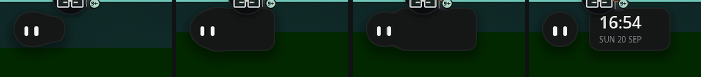

| Contract requirement | Measured |
| --- | --- |
| Emerges from behind her | Starts at her center with zero width and slides out until it is 14 px away. It is another part of **her same body**: one shadow, one rim, and a neck halfway through |
| 180 ms delay | `on hover cuerpo_zona for 180ms` |
| 170–190 ms to appear | Spring `~190ms` |
| 300 ms grace | Measured: the pointer leaves at 3,000 ms and the note folds away at 3,300 |
| Time and date | `service clock { time; date }`: provided by the system, with no logic, and wakes once per minute |
| Click opens the calendar | `emit calendar`, which the logic listens for |
| Disappears when the panel opens | `follow nota = if(note and not open and face == eye …)` |

**And she does not sink with the time note in hand.** In hidden mode there was
a 2.6 s `away` timer on her, and leaving her *toward the note* already counted.
Now one grace timer covers everything that needs her—pointer, note, card—
written with `on still`: 2.6 s from when the last thing stops needing her.
Measured: the note folds away at 3,300 ms, and she starts sinking at 5,900.

## The notification swell: one arrives

> “A small card slides in horizontally beside her—who sent it, the first line,
> and ‘now’—and she looks at it. It stays for as long as it takes to read, then
> narrows into a drop in its category color and flies along a curve to its
> place. When it arrives, she takes a small gulp. Entry 220 ms. Reading time
> 3.2 s, paused while the pointer is over it. Flight 220 ms.”
>
> “Up to four drops, one per category and newest first, descend along her right
> side from the shoulder, each with its count inside—‘9+’ from ten onward. The
> drop receiving something pulses once. Nothing loops.”

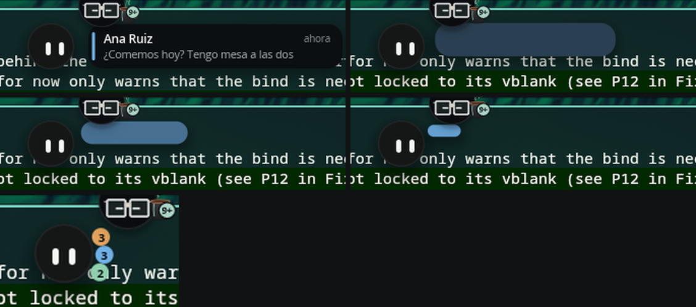

| Contract requirement | Measured |
| --- | --- |
| 8 px jump, eyes wide open, elastic landing | Marea's `alert` gesture, frame by frame, scaled by 46/56 |
| 220 ms entry | `entra ~220ms`; if she is submerged, it waits until she comes out |
| She looks at it | Her gaze leaves the mouse and moves to the card while it is being read (`atenta`) |
| 3.2 s reading time, paused by the pointer | `on still marca for 3.2s while … not sobre`: leaving it starts the timer again. Measured: 3,200 ms from when she is no longer hovering |
| Narrows into a drop in its color | A single shape: width, height, corner, and color follow `mine` |
| Flies along a curve, 220 ms | Constant sideways speed and a fast upward path: `1 − (1 − mine)²` |
| A gulp on arrival | `gulp` gesture, and the drop pulses once with an `impulse` |
| Newest first | Each drop's position is the number of newer drops, and it travels there **along the arc**: the angle is animated, not x and y, so they move down her shoulder rather than cutting across her |
| Count inside, “9+” from ten on | Yes |

**The order is by arrival, not landing.** The one being read lands 3.2 s after
the ones that arrive in the meantime, but it arrived first: each notification
keeps its turn. Verified with three in a row: messages, calendar, system →
positions 2, 1, and 0.

### When several arrive

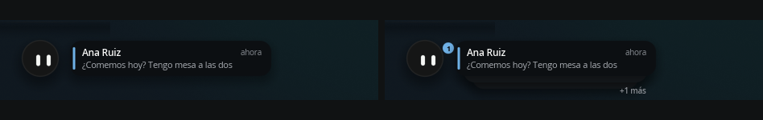

> “The cards stack—three visible and ‘+N more’—and fly together, each a little
> after the previous one. One boing with curved eyes, no matter how many
> arrive. Reading time 4.2 s; flight 280 ms.”

| Contract requirement | Measured |
| --- | --- |
| Three visible and “+N more” | Yes; the ones behind peek out by 8 px and are each 22 px narrower |
| Fly together, each slightly after the previous | 45 ms between each |
| **One boing**, no matter how many arrive | Only the first requests the gesture. A pet that jumps for every message in a group is a pet that eventually gets ignored |
| Reading time 4.2 s | 3.2 s when it arrives alone. These are two rules because a rule's `for` is a specified duration, not a count |
| 280 ms flight | Yes |
| Each arrival restarts the reading time | Yes: `marca` changes and `on still` starts counting again |

And the ones behind do not take on their color until they fly: while waiting,
they are stacked paper, and the color belongs to the one being read.

### The preview

> “When there are pending notifications, hovering opens their drops in a fan
> beneath her, with their category icons, and shows the newest one. It takes
> the time note's place. Clicking a drop opens the tray filtered to that
> category. 160 ms; closes when the pointer leaves.”

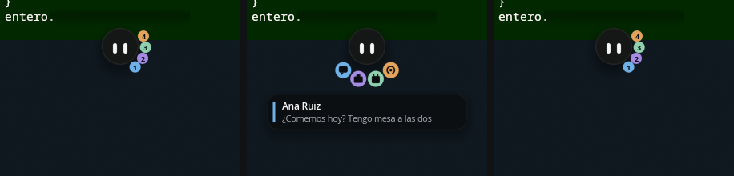

Collapsed, open, and collapsed again.

| Contract requirement | Measured |
| --- | --- |
| Open in a fan beneath her | The whole fan rotates 69° and moves 10 px away, **along the arc**: the drops move around her rather than cutting across her. When open, they are spaced 30° apart rather than 26° so they do not touch |
| Show the category icon | Collapsed, each shows its count; open, its icon. The display changes because the question changes: collapsed, how many; open, whose |
| Show the newest notification | A card beneath them with the sender and first line, entering once the drops are in place |
| 160 ms | Spring `~160ms` |
| Takes the time note's place | One or the other: with something pending, the fan appears; with nothing pending, the time |
| Closes when the pointer leaves | 300 ms of grace over the entire group—her, the fan, and the card—because the gaps among them are real |
| Clicking a drop opens the tray for that category | `cat = k` and open |

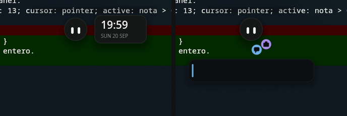

With nothing pending, the time. With two notifications, the fan in its place.

**What remains in this part:** an arrival while she is asleep, which requires
the sleep state.

### What this exposed in pleamar

While the drop was flying, **the renderer stopped for 300 ms halfway through
the flight**: the drop froze and then appeared in place. It was not specific to
this scene. The debugger showed it stopped at `vkAcquireNextImage`, waiting for
the compositor to return an image. Two issues were in pleamar—a *closed*
surface could drive the vsync timing, and three frames were presented in 2 ms
after waking—and the third was in Hyprland with NVIDIA. It now presents via a
mailbox and the renderer paces itself. The longest frame in flight went from
**300–780 ms to 17**.

For a Quickshell alternative whose argument is smoothness, this mattered more
than the drop.

## The control center

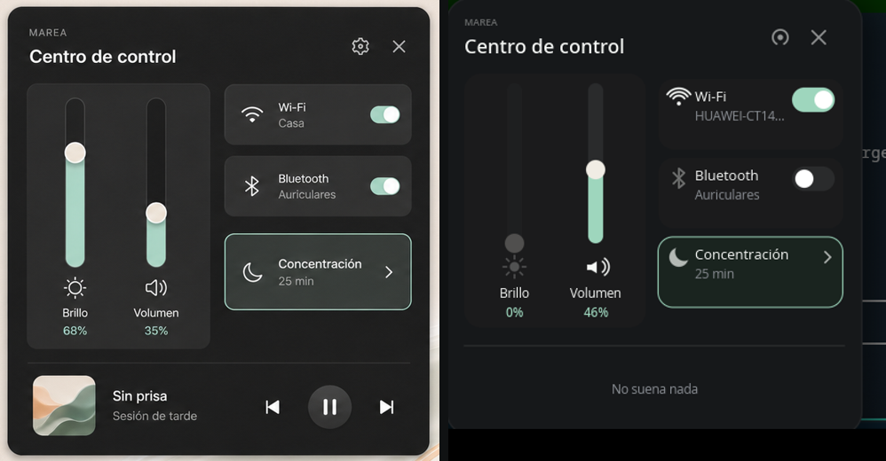

The design is on the left
(`design/concepts/2026-08-31-centro-y-apps/centro-de-control.png`), the output
on the right. The panel is 593 px wide in the design and 390 px here, so the
heights come from measuring the design and multiplying by 390/593, not by eye:
the header ends at −150 from the card center, content starts at −134, the
divider is at +121, and music at +161.

I learned that on the third try: I had placed the right column at −165, and it
overlapped the close cross.

| | |
| --- | --- |
| **The two levels** | Brightness and volume, with the icon **below** the track, the label, and percentage in mint. Thin track, mint fill, and cream thumb |
| **Three cards** | Wi-Fi, Bluetooth, and Focus. The first two have a switch; the third opens a page, so it has an arrow. Enabled Focus has a mint rim: the panel's only border |
| **The gear and close cross** | Top right, as in the design |
| **The divider and what is playing** | A divider separates the top section from music |

**I used something else before.** I had copied the current `ControlCenter.qml`—
six cards, output and microphone, an orbit strip—which is no longer this
design. It did not look like it at all.

### And now it works

The inside was not interactive, and the reason was specific: **a rule cannot
send anything to a service**. The renderer knows how to react to the mouse, but
asking the system for something belongs to the logic. This prototype had no
logic; now it has a forty-line `bolita.luau`, which is all it needs:

```lua
on("mover_volumen", function(v) sys.call("audio.volume", v) end)
on("mover_brillo", function(v) sys.call("brightness.level", v) end)
on("tocar_pausa", function() sys.call("media.toggle") end)
```

Measured by dragging with the simulated mouse: system volume goes from 0.79 to
0.27 following the finger, and the track continues to read it **from the
service**, so raising it with the keyboard key moves this same track without
anyone counting it twice.

**What cannot be operated, and why.** Brightness reads 0% and appears disabled:
this machine is a desktop and has no backlight, so the service returns
`present = false` and the scene shows that instead of lying. The Wi-Fi and
Bluetooth switches are drawn but do nothing: pleamar knows how to **read**
network state, not change it, and does not know anything about Bluetooth yet.
This is recorded as limitation B15. A switch that moves without doing anything
is a lie, so it does not move.

### It also sprouts from her

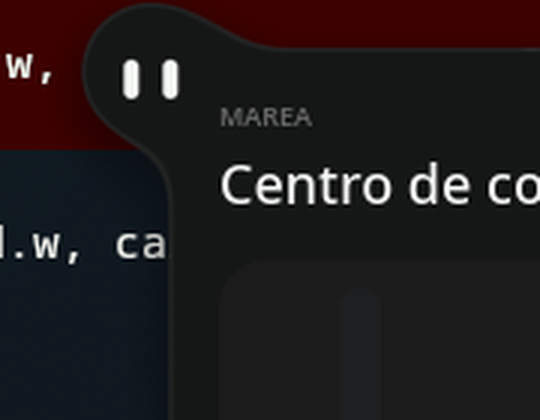

Just like the tray: the panel is in the same `body` as her body, they overlap by
17 px, and between them is a neck that nobody draws. It is not a card appearing
beside her; it is her, stretched out.

### And with layout, without a single manually specified width

The three cards overlapped: the network name slipped under the switch, and
“Focus” ran into the arrow. I had been placing them manually with coordinates
and guessing the widths.

Now each card is a three-item `row`—icon, label, and switch or arrow—inside a
`column`. The middle item requests the remaining space with **`grow: 1`**, and
its text takes that width, so **there is not a single hard-coded width in this
part of the scene**: anything that does not fit gets ellipsized automatically,
and the one with an arrow instead of a switch has more room because the arrow
takes up less space.

`grow:` did not exist when I started this. It was pleamar's G28, and it came
from this work.

```plm
row tarjeta { size: 173, 66; gap: 6; padding: 8; fill: …; corner: 14
    group { size: 20, 22;  …the icon… }
    column { grow: 1; gap: 2
        text titulo.$k { size: 13; lines: 1; color: ink }
        text sub.$k { size: 11.5; lines: 1; color: #8b8f95 }
    }
    group { size: if(k < 3, 40, 12), 23;  …switch or arrow… }
}
```

### What was off-center

Inside each card, the switch stayed stuck at the top and the Wi-Fi icon sat too
high. Two causes, and I had both of them wrong:

- **A layout distributes at `start`.** Without `align: center`, each child
  sticks to the edge along its short axis. The text looked centered because
  its two lines fill the height; the 23 px switch did not.
- **An `arc` is drawn ABOVE its point.** It is a slice of a circle opening
  upward, so its body extends from `y−16` to `y+2`: to center it, the point
  must be lowered by 7. With the point in the center, the icon appears too high.

And a third issue that was pleamar's: with `size:` specified, `align:` still
centered **relative to the tallest child** rather than inside the requested
box, so a 66 px card with 32 px of content left everything at the top and the
empty space below. Now, along the axis, the `size:` value defines the box used
for alignment.

### Pages emerge from their cards

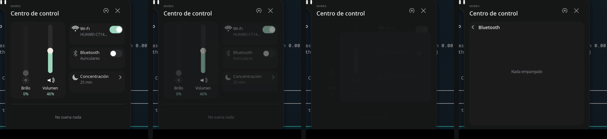

Clicking a card opens its page, and **the page emerges from the card**: it grows
from its place until it fills the panel, while the front page disappears. It is
not one screen replacing another; it is the same card, opened. It is the same
gesture as the tray emerging from her, one level down.

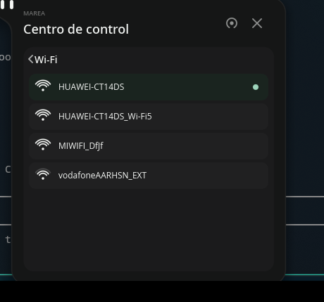

And they show real data from this machine:

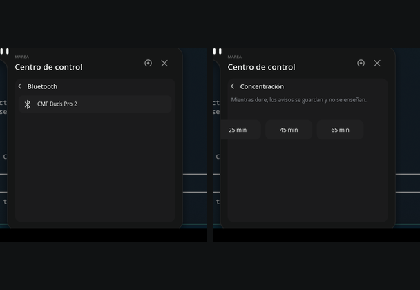

| | |
| --- | --- |
| **Wi-Fi** | Available networks, with signal strength shown by the same arcs as the icon, the connected network marked, and each network listed once—one entry per antenna appears, and the one with the strongest signal is kept |
| **Bluetooth** | Paired devices, with the connected one marked |
| **Focus** | What it does, explained, and three durations |

**And the switch really does turn things on and off.** It has its own zone above
the card's: clicking it toggles the radio, while clicking elsewhere opens the
page. Previously the card body handled both, and the switch did nothing, so
with Wi-Fi off **there was no way to turn it back on from the panel**—a switch
that only turns things off is not a switch. The logic reads the current state
first and sets the opposite rather than assuming it: if someone changed it
outside the panel, this still gets it right.

**And this is where the logic earns its keep.** pleamar knows how to **read**
network state, but not list or change networks—that is its B15—and it knows
nothing about Bluetooth. So this is not done by the scene: it is done by
`bolita.luau`, which asks `nmcli` and `bluetoothctl`, exactly what the logic is
for. The scene sends nothing; it displays what it is told.

Clicking a network connects to it, **but only if it was already saved**:
`connection up` does not invent a password, so this cannot join a neighbor's
network. A new network requires its password, which is a conversation, not a
click. And each headset's `mac` travels in its record even though the scene
does not declare it: the logic stores what the scene does not need to know.

### Closing, in three beats

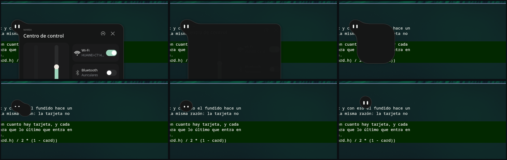

> “She moves aside to present the card; on close, the content fades first, then
> the geometry folds back to the little ball. | 290 ms to open; 50 ms fade
> + 210 ms to close.”

The contract's timings were there, but all three things happened **on top of
each other**: the card shrank after she had already left, so she swallowed
nothing; a lone box remained, fading in a corner. Now they happen in order, and
that is the whole trick:

| | |
| --- | --- |
| The content fades out | 50 ms |
| She swallows it: the card narrows toward her—the neck pinches itself, as it already did | Swallowed at **234 ms** |
| She gulps when almost nothing remains | `on change card < 0.2` |
| **Then** she returns to her place | Starts at 200, crosses her place at **417**, overshoots by **19 px**, and settles at **733** |

Three details make this liquid rather than a box:

**The corner gets rounder as it leaves.**
`corner: max(22 * card, min(w, h) / 2 * (1 - card))`: the design's corner radius
dominates as soon as there is a card, and the less of it remains, the rounder
its corner becomes proportionally. So the last thing to enter is not a little
box with sharp corners—it is a drop. Opening works in reverse: it comes out as
a bulge from her and squares off as it reaches full size.

**She returns on her own spring.** Her position is no longer “how open the
card is”: it is a separate `prop` (`sitio`) with a less damped spring
—`spring vuelta = 165, 16`—so she slightly overshoots and settles instead of
reappearing there. The path also curves: height follows a square, so she exits
and enters **from above** instead of crossing diagonally. Something with weight
does not travel in a straight line.

**And she leans toward where she is going, without being told.** It comes from
the **velocity of her own spring**:
`follow lean = clamp(vel(sitio) * -2.6, -8, 8)`. She leans as she starts,
straightens as she arrives, and does the same in both directions because the
calculation is the same. Measured maximum: 7.4°.

When she arrives, the water at the edge responds: it dips slightly around her
and rebounds—3.8 px of movement—like something landing on a non-rigid surface.

**Sinking back in is visible too.** Coming out of the water had two bounces, a
wave traveling across the sheet, and a drop that remained; going back in had
nothing, she disappeared silently. Now, once she has gone in, the surface
**closes over her**: it dips where she was and the same ripple spreads from
there, over 760 ms. Leaving is an event too.

### What this exposed in pleamar

**There was no brightness service.** It is the first control anyone looks for
in a control center. Now there are `brightness.present` and `brightness.level`.

**`show:` did nothing** outside a component copy, even though it was available
everywhere. Now it works wherever offered, and disables the zone too.

**And a zone declared last consumes clicks from everything below it.** This has
happened three times: with the corner panel, the swell rows, and this entire
panel. The click belongs to the highest zone, and “highest” means declared
last. Grace zones go below.

## The tray: the swell

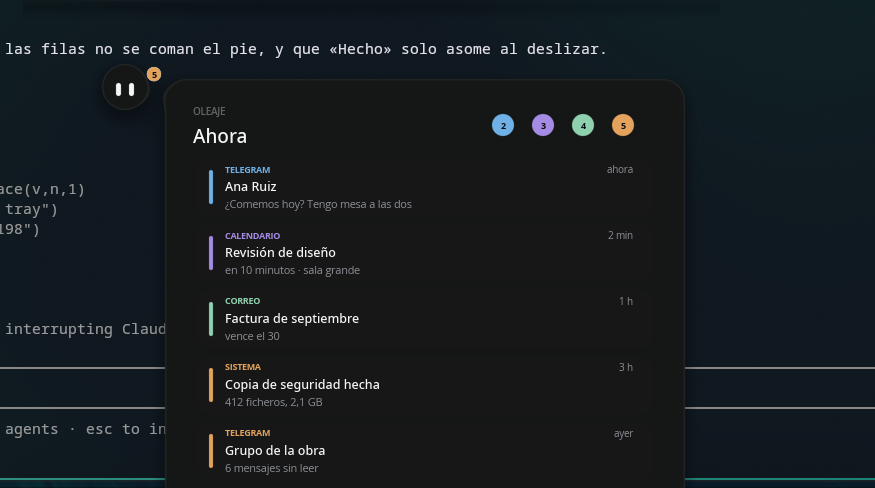

**The card does not appear beside her: it sprouts from her.** It is in the same
`body` as her body, so they share a silhouette, shadow, and rim, and between
them is a neck that no one draws—it comes from merging them, like the water's
edge.

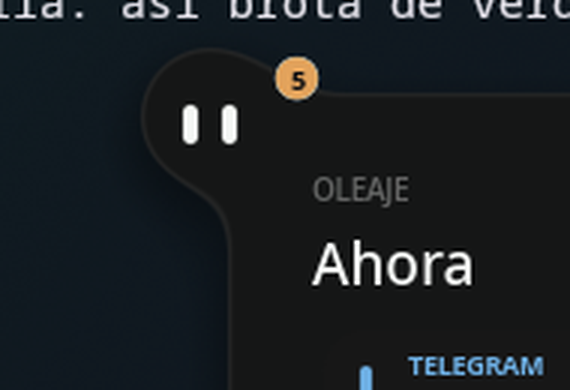

This took a while to understand: with the other card's 40 px gap, there was
nothing to merge, and they remained two adjacent things. They overlap by 17 px,
and then the merge creates a real neck.

### Open the Swell tray

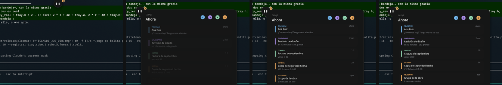

> “She rises 5 px, the card sprouts from her, the drops move to the rail—which
> enters from a smaller size—and the rows arrive one after another. 240 ms; one
> row every 35 ms.”

| Contract requirement | Measured |
| --- | --- |
| Rises 5 px | Yes, together with the card |
| Card sprouts from her | A `blend` that forms a bell curve while opening and stays at 24: a thick neck as it emerges, a fillet when open |
| Drops move to the rail | From her shoulder to the header, **along an arc**: the angle is animated, so they move around her instead of cutting through the inside |
| One row every 35 ms | 35 ms, and each enters by rising 26 px on a live spring. That is the swell: not a list that appears, but one that arrives |
| 320 ms to close | And it empties **from bottom to top**, the way things really empty |

### Resolve a group

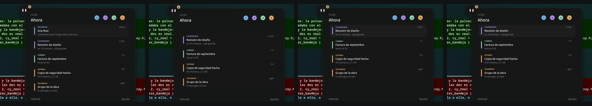

> “The row moves right, a drop flies back to her, and the count in its drop
> ticks down.”

The drop **starts attached to the color bar in its row** and detaches as it
leaves: the pinch is not drawn; it comes from the distances. Measured from a
click: the row is gone in 220 ms, the drop reaches her shoulder at 380, and
that category's count drops from 2 to 1 with its pulse.

And the rows below **move up to fill the gap**. This is not free: in pleamar a
model does not have identity yet (limitation G12), so each row's position is
“how many live rows are above me,” written separately for each row, and
followed by a spring.

### Undo, with its fuse

> “‘Undo’ for 5 s, with a fuse that burns down.”

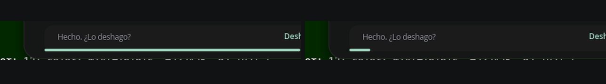

Just triggered and about to go out.

An exact five seconds at a **constant rate** does not come from a spring; it
comes from a gesture, which is a timeline with its curve. `5s linear { mecha: 0 }`,
and the next frame after it ends emits that it has gone out. That is what makes
a fuse look like a fuse instead of something that slows down at the end.

Measured: the fuse goes from 1.00 to 0.02 in 4.7 s and goes out on its own. And
Undo restores the row—it moves back into place—and the count in its drop goes
back up with a pulse: verified with the simulated mouse, `viva.1` from 1 to 0
and back to 1, `n.1` from 2 to 1 and back to 2.

While Undo is available, the fuse takes the footer's place: it is more urgent
than a “History” link.

### Swipe: done or dismissed

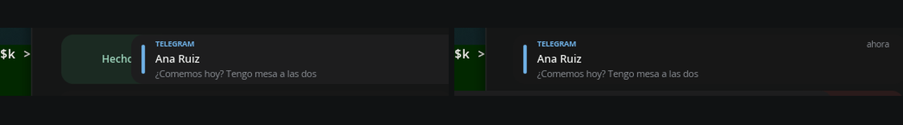

> “‘Mark as read’ or swipe the row to reveal ‘Done’ and ‘1 h’… Dismiss does
> not send a drop: dismissed items do not come back.”

The row follows the finger, and decides when released: after 92 px it leaves in
the direction of the swipe; otherwise it returns on its spring. To the right,
**Done**, and a drop flies back to her. To the left, **Dismiss**, and **nothing
returns**: that is what distinguishes the two, and what the contract says.

Measured: swiping left turns `viva` off and the count in its drop **stays where
it was**; swiping right turns it off and the count **decreases**, because the
drop arrived.

The revealed actions go in the gap the row leaves, not following it: placed on
top, they were underneath it and never visible. And a tap—releasing where you
pressed—opens it; it does not mark it done: `on press` does not work here,
because dragging starts with a press and would mark it done at the first pixel.

### An urgent item is not grouped

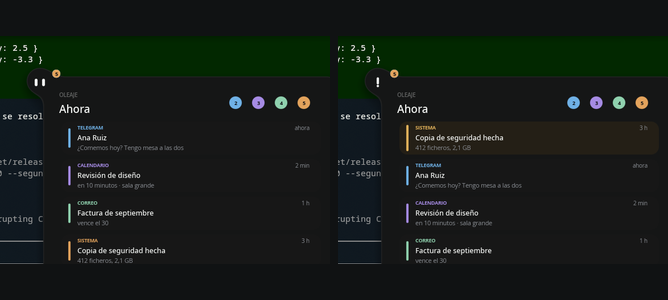

> “An urgent item is not grouped: its own row, at the top, in amber. It opens
> the tray without taking the keyboard, and puts an exclamation mark on her
> face, a drop of sweat, and a short jump.”

Each row's position is “how many live rows are before me,” and an urgent one
goes before all of them: its position changes from 2.94 to 0, and the others
move down. Amber overrides its category color, because what matters about that
row is no longer whose it is, but that it is urgent.

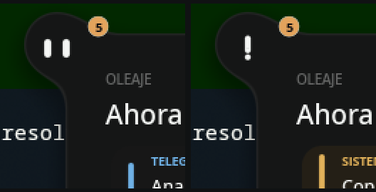

And her face looks alarmed: the left eye stretches into the exclamation's stem,
and the right becomes its dot; both are centered—an off-center “!” is not an
“!”—with Marea's short jump. **Once per episode**, from the first urgent item
until none remain: a notification that jumps every time eventually gets
covered by a window.

### Demo mode, and what it exposed

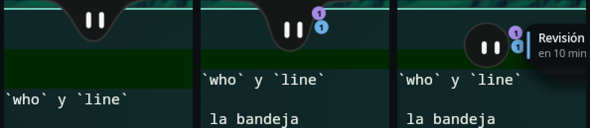

Until now, the five notifications were fixed text in the scene, and I triggered
`notice` manually with `--decir`. Now the logic sends them: a sequence that
arrives on its own—one, another, **two in a row** to show the burst, another,
and an urgent one at the end—and fills the tray as they arrive. What crosses
the boundary is exactly what the real service would send: `cat`, `who`, `line`,
and the event.

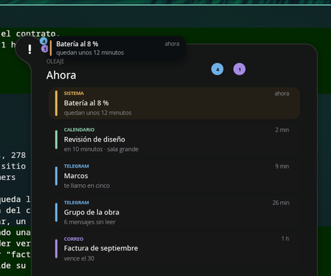

pleamar **can receive desktop notifications**—`sys.watch("notifications")`
provides the live list, and `notifications.invoke` / `dismiss` act on them—but
this permission is deliberately not granted here: whoever requests it first
gets it, and on this machine that is Marea. A prototype should not take
notifications away from the real bar. When permission is granted, the only
thing that changes is where they come from.

**And the first real notification exposed a bug that had been hidden for
weeks:** a row's color came from **its position in the list**, not its category.
With five sample rows—one per category, in exactly that order—it was never
noticeable; as soon as two Telegram notifications arrived in a row, they had
different colors. This is exactly why you connect something to data you did not
choose yourself.

### The drops: arranged with water, each opening its own category

Three things that only show up when there are real drops in front of you:

**There was a gap in the fan.** The urgent drop moves to position 0 and the
others move down one to make room… but they also counted it as “one newer than
me,” so they moved down two places, leaving a gap between the top drop and the
others. The recency count now **excludes the urgent item** and adds its
position just once.

**Moving close to a drop makes it wobble and grow.** These are two distinct
things, and they read as two: the **wobble** is a greeting—a shove to a lightly
damped spring, the same `chapoteo` used by the water's edge, which squashes it
12% in opposite directions on each axis and leaves it trembling—and the **16%
growth** means “I am looking at you,” lasting as long as the pointer is over
it. Without the second, it does not read as something clickable.

**And other zones were stealing her little hand cursor.** The cursor, like the
click, belongs to the **last declared zone**, and the two surrounding grace
zones—the time and fan zones—were written afterward: over a drop, the pointer
was still an arrow. That makes six times this has happened. In addition, the
zone now grows with the drop: 14 when tucked away and 20 when open; a fixed box
of 24 left half of the open drop outside it.

**And clicking a drop opens the Swell tray filtered to its category.** If you
ask about the blue drop, you want to see messages, not everything: the header
changes from “Now” to the category name, only its rows are shown, and a “View
all” option appears to leave—without it, this would be a dead end. Opening it
from anywhere else—clicking her, the arriving card, or an urgent notification—
opens everything.

**The header uses columns.** Title on the left, pill rail in the middle, and
“View all” on the right; all three positions come from **a calculation starting
at the right edge and moving inward**: when placed manually, the fourth pill
landed right over the button. The pills are positioned by **their order**, not
their category number, so if one is missing the others close ranks instead of
leaving its space empty.

### Dragging a row: staying inside the panel and stretching

Dragging a row to the side made it **leave the panel** and float over the
desktop, which is exactly what a panel should not do. Rows are now clipped to
the tray itself: anything crossing its edge is clipped there.

Dragging a row **stretches it**, like a drop: it lengthens by 12% of the drag,
gets 4.5% thinner, and rounds off until it is almost a pill. On release, the
stretch reverses with the spring that returns it—nothing animates it separately—
and if it crosses the threshold it leaves fully stretched, as something liquid
does when released with force.

### Closing the Swell: fold first, then return

Her position was driven by the tray geometry: when it closed, she returned
**while it was folding**, and two things on top of each other cannot be seen.
Now it works like the control center—the thing closing goes first, and she
follows behind: the tray finishes folding at **217 ms**, and she crosses her
position at **417 ms**.

And **she does not sink while one of her panels is open**. The sinking grace
period checked the time and card, but not the tray, search, or her menu: 2.6 s
after releasing her, she sank into the edge with the Swell open, leaving the
tray hanging from half of the ball.

### Sweat, the rising drop, and what was left over

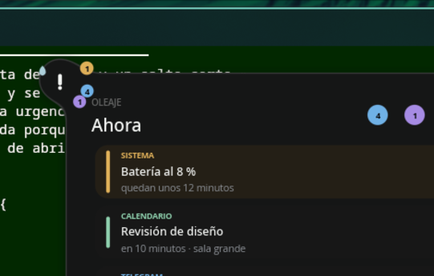

> “An urgent item is not grouped: its own row, at the top, in amber. It opens
> the tray without taking the keyboard, and puts an exclamation mark on her
> face, **a drop of sweat, and a short jump**; **the amber drop rises and stays
> at the top for as long as the urgency lasts**.”

- **The sweat drop** appears with the exclamation mark, slides 9 px, and leaves:
  **1,266 ms** measured. It is a reaction, not a state—the amber drop is what
  lasts for the duration of the urgency—and it goes to her left, because the
  tray has just appeared on her right.
- **The exclamation mark is a reaction, not a state.** It lasts for the scare
  (measured **1,737 ms**) and then disappears. The amber drop is what stays “for
  as long as it lasts,” which is why it rises. The exclamation mark used to
  depend on there being no urgent items, and since unresolved urgent items do
  not disappear on their own, she kept the “!” all afternoon. “Once per
  episode” cannot depend on the face either, since the face returns to normal:
  its own fact tracks this and is cleared when none remain.
- **And when she is submerged, the whole fan lowers by 30°.** The top edge of
  the screen is up there, and the top drop—which is now the urgent one—was
  sticking out past it. “Nothing sticks out above her head” also applies when
  her head is halfway submerged.
- **The amber drop rises and stays.** The drop for the category with an urgent
  item moves to position 0—the top of her shoulder—and the others move down
  one to make room; measured: **416 ms** to arrive, and it stays amber for the
  duration, like its row. Once resolved, each drop returns to its recency
  position without anyone repositioning them: a drop's position has always
  been “how many are newer than me,” and now that includes the urgent one at
  the front.
- **And the jump happens when she is visible.** It was there from the start,
  but if a notification arrived while she was submerged, the gesture happened
  **underwater** (620 ms of travel) and had ended by the time she surfaced.
  Now she jumps as she comes out.

Two more things showed up when viewing it all together instead of in separate
screenshots:

- **The small card stayed above the tray**, repeating its first row. Now, when
  the Swell opens, it leaves: it does not disappear; **it flies to its drop**,
  the trip it had to make anyway. Measured: **367 ms** from the tray opening.
- **And the tray that opened automatically stayed open forever.** `away` only
  counts for something that was entered, so a tray opened by an urgent item
  that nobody visited never closed. Now, if no one approaches within **7 s**,
  it closes by itself; if the pointer is over it, it does not.

**What remains for the tray:** none of this. The remaining piece is an arrival
while she is asleep, which requires the sleep state.

## The Haven

> “The crossed-out bell in the control center closes the card and leaves Marea
> awake inside a membrane that exactly matches her configured diameter. The
> moon sits in the upper-right quadrant and the water gently changes slope,
> without moving her body or the pearls.”

Do not disturb, but **awake**: she is still here, attentive, and saves what
arrives while you focus. Everything that happens takes place **inside her
silhouette**: entering Haven does not enlarge her by even one pixel.

### Enter

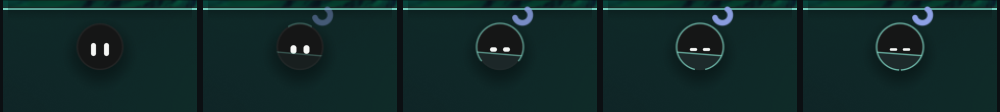

> “A wave travels once around the membrane, the blue moon appears, and the eyes
> lower into two relaxed strokes. Pending categories become pearls beneath the
> waterline. | 320 ms; then it becomes completely still.”

There is no crossed-out bell here: there is a **Focus** card, as shown in the
control center design, and its page is where you choose how long it lasts.
When you select a duration, **the first thing that happens is the panel
closes**: leaving it open above her would be the opposite of what you just
asked for.

The membrane is an `arc` with **the same radius as her** and
`span: 360deg * dibuja`, so the wave drawing it is the counter itself growing:
there are not two shapes; one is closing. Measured: `calma` goes from 0 to 99%
in **317 ms**, and the wave starts 33 ms later and takes another **317 ms**—
`after 30ms` is there so you can see it start, not so it starts before she does.

### The tide

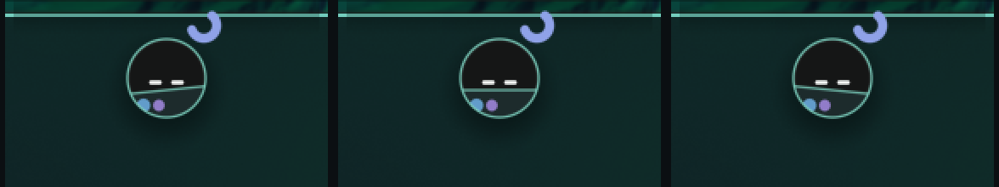

> “The water gently changes slope, without moving the body or the pearls. |
> The tide completes one round trip in 7.6 s.”

`wave marea = 1 at 0.827`: 2π/0.827 = 7.597 s. Measured between two upward
zero crossings: **7.60 s**. It is the only thing moving in there, and it moves
like water. The three frames are captured 1.9 s apart, a quarter of the cycle.

The water is clipped to her (`clip inset 0 ellipse`), so the line **clips
itself** where her silhouette ends: there is no need to calculate where.

### What gets saved

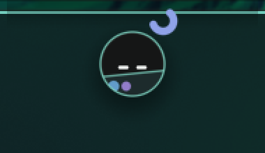

> “The notification is saved without a card, jump, or opening. Its category
> appears or grows beneath the waterline; the count updates in the capsule. |
> No outward trajectory or loop.”

Three notifications—two messages, one work item—and what you see are two
pearls, the blue one larger. Measured: `n.1 = 2`, `n.2 = 1`; the pearl appears
in **317 ms**, grows by 0.6 px per notification up to three, and pulses once
when another arrives, with the same impulse as the shoulder drop: it is the
same news displayed somewhere else.

And no drop remains on the shoulder:
`follow hay.$k = … * (1 - calma)`. Underwater, they are pearls.

### One permitted urgent notification

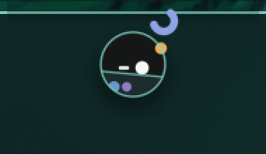

> “An amber pearl appears on the membrane, and only the nearest eye becomes
> round to look at it. The tray does not open and focus does not change. |
> 1.1 s; once per urgent episode.”

Measured: `mirada` 0 → 1.03 → 0 in exactly **1,100 ms**. A second urgent
notification in the same episode does nothing, just like the alarmed face:
the irritating thing about an urgent notification is not the first one, it is
the fourth.

What is stored goes **under** the water, and what is happening goes **above**:
the amber pearl sits on the membrane at three o'clock, far from the moon—the
two together looked like one strange thing on the edge.

### Hover

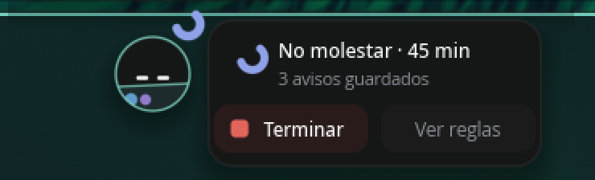

> “A compact capsule appears with the status, saved notifications, ‘Finish,’
> and ‘View rules.’ It takes the place of the time and folds away when the
> pointer leaves the group. | 160 ms to open; 140 ms to close.”

It takes the place of the time **and emerges like the time display**: its box
is inside her body, starts at her center with zero width, and slides right with
a neck that nobody draws. They share a silhouette, shadow, and rim.

Measured: **150 ms** from 1% to 99% when opening and **150 ms** from 99% to 1%
when closing, with 300 ms of grace before it starts closing. A `follow` does
not know which direction it is coming from, so opening and closing are two
rules for the same thing.

And it says what is true: “Do not disturb · 45 min” with the actual minutes
remaining, “3 saved notifications” with the live count, and the panel's Focus
card reads that same state—“On · 45 min”—instead of keeping its own.

### Return

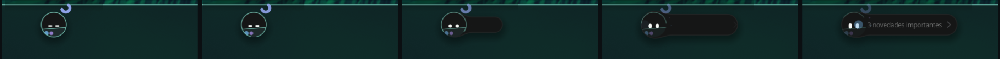

> “The membrane and moon dissolve and a single summary appears. Regular drops
> remain hidden while the summary is visible, to avoid replaying the entire
> queue all at once. | Wake-up 500 ms; summary 4.2 s.”

Entering takes 320 ms and waking takes 500: **they are different journeys, so
they do not use the same spring**. Measured: `calma` reaches zero **507 ms**
after clicking “Finish”; the full summary appears at **500 ms**, stays for 4.2
s, and folds away over another 300 ms.

The summary also emerges from her, with its neck: see frames 3 and 4 of the
strip. The last thing Haven does is return what it saved, and it returns it by
having it emerge from her.

And it ends by itself: one minute less every minute (`every 60s while remanso and
queda > 0`), and when it reaches zero she comes out. A “do not disturb” mode
that you have to remember to turn off stays on all afternoon, and then it is
not a haven but a blockage. Measured with `--decir "fact queda 0"`: the summary
starts **on the same frame**.

### What is not here

- **The crossed-out bell:** the entry point here is the Focus card, as shown in
  the control center design. It is the same action in a different place.
- **Automatic sleep suspended for its duration:** there is no sleep yet, so
  there is nothing to suspend.
- **The `zZ` for Sleep**, for the same reason.
- **“View rules”** sends its event and the logic logs it; it would open a
  screen that does not exist in this prototype.

### What this exposed in pleamar

**With reduced motion, autonomous animations kept going.** The contract says
the tide “stops with reduced motion,” and in pleamar `--movimiento-reducido`
settled springs and froze gestures, but `blink`, `wave`, and `spin` continued
looping: exactly the things that should not keep turning. Not anymore: the eye
stays open, the wave stays halfway through its journey, and the spin stays
where it was. Measured: the tide stays at **0.0000 for all 32 frames** over
five seconds—and there are 32, not 300, because with nothing moving, it
**sleeps**.

**And the fourth time with zones.** The capsule's grace zone, declared last,
captured the click on “Finish”; and the time zone, disabled in Haven, did two
things at once: it blocked clicks beneath it and made “you are outside” true,
closing the capsule 300 ms after it opened. This is no longer an oversight:
**it is a pattern in this scene**, and that is why it is documented where it
happens.

## Her menu, the right-click menu

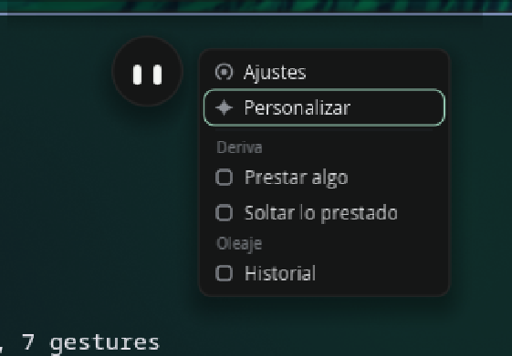

> “Click opens panels that close when the pointer leaves the pet–bridge–card
> group; **right-click opens her menu**, which closes the same way when leaving
> her and the menu. Clicking gives it keyboard focus, but does not leave them
> stuck to the screen.”

Until now, right-click did nothing here, and therefore closed the program: it
is pleamar's emergency exit. Now it does what the contract says.

At the top are the two built-in rows—**Settings**, which is what right-click
used to open, and **Customize**. Below a divider are the entries provided by
plugins, **grouped by plugin name**, so an entry called “History” says whose
history it is. The built-in entries are written in the scene because they
belong to it: a plugin cannot remove Settings. The others are sent by the
logic—hard-coded here, since there is no catalog—with one extra piece of data:
whether it opens a group. It is a count, not a coordinate; a column lays out
each row.

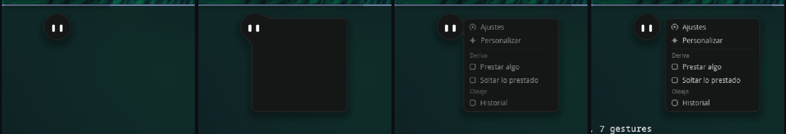

And it emerges from her: its box is **inside her body**, starts at her center
with zero width, and slides to the right with a neck nobody draws (second
frame). It uses the same position and box as the time note, because it is the
same thing: what she has to say when you ask her there. Opening it dismisses
the time, fan, and Haven capsule: the last one to arrive wins.

Measured: **185 ms** from 1% to 99% on opening, **183 ms** to fold away, and
300 ms of grace after leaving the group before it starts closing. It also
closes with Esc, another right-click, choosing an item, or opening the card.

**Two different highlights because they are two different things**: the
pointer highlight fills the row, while the keyboard highlight is a mint rim.
The arrows move the selected row and Enter chooses it; Enter without a
selection chooses the first row, Settings, so what right-click used to do is
still one key away. The keyboard is requested **only while the menu is open**
(`keyboard: on_demand while menuab`), which is what the contract means by not
leaving them stuck to the screen.

### What this exposed in pleamar

**The emergency exit took the button away from any scene that used it.**
Right-click closes the program when no scene uses it, but as soon as one does
(`on press right`), it disappeared entirely: there was no way to have a menu
and still close the prototype. But the renderer is the one that knows whether
the click landed on something, since it checks the zones. Now it decides: if
there was no zone under the pointer, close; if there was, the scene gets the
click. Her menu appears over her, and two finger-widths away it closes as usual.

**And the fifth time with zones.** The menu's grace zone, declared after its
rows, captured all its clicks. No need to explain it again: in this scene, a
grace zone **always** goes below what it wraps.

**And a standalone clip extends farther than it appears to.** The card's clip
includes everything after it up to the next named surface, so the menu,
declared farther down, was clipped to a closed card: an empty box. Its drawing
now comes before the clip, and its zones stay at the end, where they belong.

## Measurements from the design

From `design/concepts/2026-09-12-reposo-vivo/referencia-real-limpia.png`, which
preserves the original size:

| | |
| --- | --- |
| body | 46 px diameter |
| eyes | 5 × 13, rounded ends (`corner: 2.5`) |
| spacing | 13 px between centers |
| eye height | 2.5 px below the center of the body |

## Search: apps, files, and folders

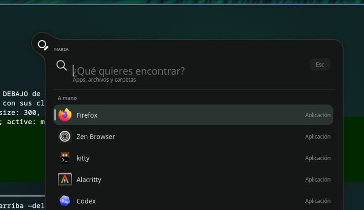

The app drawer design has a note over it, dated August 31:
**“the icon drawer is superseded as a design direction by the universal search
for apps, files, and folders.”** So this is not an icon grid: it is what
replaced it, and the sequence design shows six beats—it rests, moves aside,
**searches**, finds, opens, and folds away.

The third beat is what makes it hers, rather than just another launcher.

### Her eyes become a magnifying glass

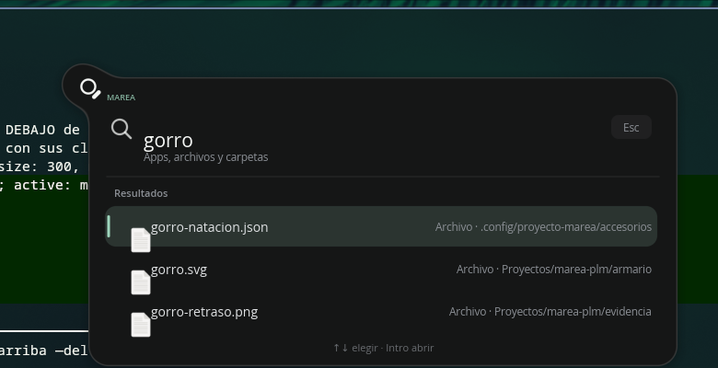

The ring is the left eye opened to 17.4 and hollowed out with a disk the color
of her body—the same trick as the countdown diaphragm: everything here is
distances, and **a hole is just another shape**. The handle is the right eye,
stretched to 4.4 × 11.6, rotated 45°, and shifted to the corner of the ring.
Both move to the center, because a magnifying glass does not have two positions.

There is no new face: this is step 8 of **the same chain** that turns the eyes
into the level, countdown, camera, recording dot, exclamation mark, Haven
stroke, and sleep line. The face is not replaced; it bends until it becomes
something else.

### And the panel emerges from her, like everything else

640 wide—the design's 780 scaled by 46/56—and **as tall as its list requires**:
`follow bh = 176 + lista.height`, so it grows and shrinks while you type
instead of leaving an empty black space. Inside is what the design shows:
“MAREA,” the field with its magnifier and “Esc,” “Apps, files, and folders,”
and the footer “↑↓ select · Enter open.”

Three things that do not show up in a screenshot:

- **Selection is a single marker that travels.** One row does not light up
  while another turns off: a spring moves to the selected row, so arrow keys
  feel like moving something.
- **The list enters in sequence**, using **a single spring**: `pase` goes from
  0 to 1, and each row uses it with its index subtracted
  (`clamp(pase * 8 - índice, 0, 1)`). It is the same approach as the tray's
  swell, for the same reason: a list that appears all at once is a table, not
  something arriving.
- **When she opens something, she gets happy**: a quick wink and a jump, 600
  ms. She is celebrating finding it.

### What is underneath

The applications are **the real ones**: pleamar's `apps` service reads the
`.desktop` files, with their icons and order, and `apps.launch` opens them.
Files and folders are searched by `fd` under your home directory, with three
rules that emerged from watching it work:

- **Do not search with fewer than three letters.** A one-letter `fd` query
  returns half the home directory—thousands of paths that neither fit nor
  mean anything—and only makes the list jump with every keystroke.
- **Discard results that arrive late.** Record the query that launched the
  search and, if it is no longer current when results return, discard them.
  Otherwise typing quickly leaves results from three letters ago.
- **“By hand” does not mean “first alphabetically.”** Without usage data, a
  short list of familiar apps is better ordered than alphabetically, which
  started with “Avahi SSH Server Browser.”

### Three things this exposed

**A standalone clip includes everything that follows it.** Search's clip
swallowed the entire menu—declared farther down—and its zones too: clicking
“Search…” did nothing. This is already in the guide, and happened again; now
each clip is inside its own group, where it belongs.

**Requesting the entire keyboard moves the pointer.** With
`keyboard: exclusive`, the compositor reconfigures the surface and sends a
“pointer left” event: with the mouse still, the menu closed by itself 300 ms
after opening because its grace zone no longer contained the pointer. Search
opens on click, so `on_demand` is enough and the pointer stays where it is.

**An image's `at` is its corner, not its center**—unlike a box or a figure.
Centered as if it were a center, the icon appeared 8 px below its row. This is
now documented in the pleamar reference, which had not said so.

## Sleep

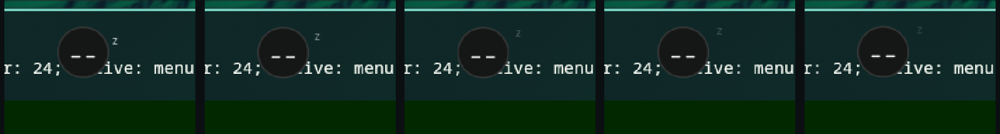

> “**Falling asleep**: eyelids lower, she nods gently, then settles. 1.24 s.
> Starts when ‘Sleep’ is pressed or after 45 s of inactivity.”
> “**Asleep**: eyes like little lines, gentle breathing, and a discreet ‘z’.
> 3.6 s cycle.”

Sleep is not Haven, which is why they are two things rather than one switch
with two names: in Haven she **stays awake and attentive**—her eyes lower into
two strokes but do not close—and here she is absent. Everything else follows
from that: automatic sleep is suspended while Haven lasts, because she is
focused, not absent.

| | |
| --- | --- |
| falling asleep | **1,217 ms** measured (contract: 1.24 s) |
| waking up | 380 ms—no one wakes up slowly when called |
| the nod | 420 + 380 + 440 = the contract's 1,240 ms, in three beats |
| breathing | a **`posture`**: repeats while true and stops when it is no longer true. 3.6 s cycle and 1.1 px of travel, compared with 2 when awake |
| the “z” | one every 3.6 s: rises, opens, and dissolves |

Two things the layout decided on its own. The **“z” goes beside her, not
above**: the screen edge is above her—the same reason drops fall down her
shoulder—and above her head it was half clipped. And **“Sleep” lives in her
menu**: in Marea it is the `zZ` in the control center, but this control center
follows the design—three cards, none of them Sleep—so it goes with Settings and
Customize, where the things she does live.

### One arrives while she is asleep

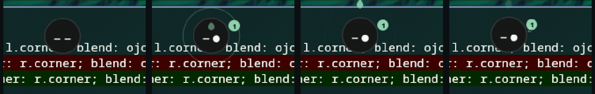

> “**It does not wake her.** A drop the sender's color forms hanging from the
> edge above her head, detaches, and sinks into her; a wave in that color
> spreads, the drop at her side pulses, and she opens **only her right eye**
> toward the drop, closes it, and breathes a little deeper. A critical one
> does wake her and open the tray. | Drip 420 ms + 90 ms hanging + 190 ms
> InQuad fall. Wave 760 ms. Eye 280 ms, open for 700 ms.”

No card, no jump, no opening. The drop forms at the top edge—from the same
place she hangs when submerged, because it is the same water—then detaches and
sinks; a ring in its color spreads from where it fell, and the drop on her
shoulder pulses. Measured: **367 ms** to form, **317 ms** from detaching to
being inside (90 hanging + 190 falling), **684 ms** total; the eye opens in
**283 ms** and closes **950 ms** later.

And what the drop carries is counted when it **arrives**, not when it is sent:
the `direct` that increments the count is part of the event that it has sunk.
The drop **is** the arriving notification, so the count goes up when it enters.

The other sleep behavior that appeared in other contract rows but was not
implemented because sleep did not exist: the time note does not appear while
she is asleep, and neither does the level on her face—the volume key is not
directed at her—and an urgent notification is the only thing allowed to wake
her.

## The wardrobe: an accessory is not a drawing pasted on top

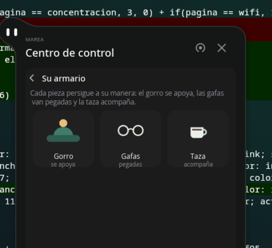

> “An accessory is not a drawing pasted over the little ball. It is a separate
> piece, with its own geometry, pivot, and separable layers… **personality
> lives in the piece, not in the face**: there is no need to invent eye states
> to show that she is investigating; it is enough for the hat to lag behind her
> a little.”

Draw an SVG with named layers, drop it in `armario/`, and that is it: it is a
pleamar `figure`, so each layer is a **real path**—it can be tinted, merged,
rotated around its pivot, and scaled without pixels—and editing the file
reloads it on screen without touching the scene.

### Zones are not positions; they are physics

What makes a piece hers is not where it is drawn: it is **how it follows**.
That is the entire library (`comun/accesorios.plm`), and the piece is nested
inside, so the physics does not know what she is wearing.

| | how it follows | who uses it |
| --- | --- | --- |
| `Apoyado` | lightly damped spring: lags, overshoots, and settles. Follows **her gaze** as well as her body | the hat |
| `Pegado` | nothing: hangs from her body and inherits its rotation, squash, and jump for free | the glasses |
| `Acompana` | soft spring with more give, and floats even when she is still | the cup |

“The ball follows the cursor; the hat follows the ball”: if what she does to
follow you is **look**—this ball does not turn its head; it turns by looking—
that is what the hat needs to follow, or it stays still precisely when you most
expect it to move. That is why gaze enters the target with its own factor.

And lag in glasses would mean they are slipping. That is why `Pegado` follows
nothing: attached to her body, it inherits everything. What is passed in is
**her** rotation and squash, with her center as the pivot, and the piece is
positioned inside it: that way it squashes just like her face, not around
itself.

**An attached piece is measured against the face underneath it, not against
itself.** Her eyes are 5 × 13 and 13 px apart center-to-center, 2.5 below the
center: the lenses are ellipses at ±6.5 that comfortably contain them, and the
SVG is drawn 1:1 at the pixels where it is rendered so this is immediately
clear. They used to be 2 px **above** and half a gaze off, so the glasses sat
on her forehead and looked elsewhere. Her face position is now declared once—
`cara.dx`, `cara.dy`, `cara.baja`—and both the face and its attached pieces use
it: write it twice, and the glasses become misaligned as soon as someone
changes either copy.

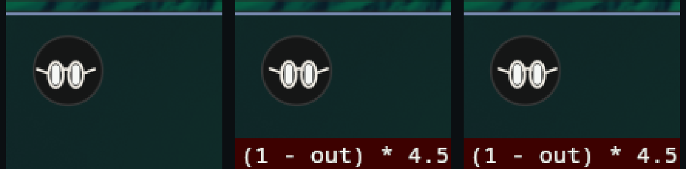

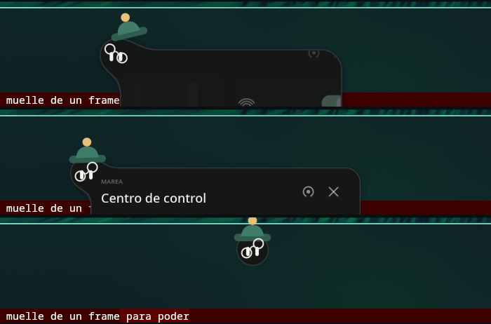

### Following and lagging are two different tests

The contract says this explicitly, for a reason: the old test checked that the
piece was not in the same place as the body, and **that is equally true if the
piece never moves**; the hat stuck in place passed. Measured separately, as she
crosses half the screen while opening the panel:

| | |
| --- | --- |
| follows | **0.00 px** error at rest |
| lags | **16.0 px** maximum lag |

The 16 px limit is deliberate. The spring is still a spring—it produces lag,
overshoot, and settling—but the visible effect is bounded: without the limit, a
240 px journey in 290 ms left the hat **150 px** from her head, which is not
lagging; it is leaving it behind on the other side.

### What comes for free

- **The angle is not animated; it is the lag.**
  `rotate: clamp(dx, -9, 9) * 1.5deg`, where `dx` is how far behind she is. If
  it does not lag, it does not tilt.
- **“Aha!” is not a special case**: it is the overshoot passing a threshold
  (`on change dx > 7`), producing a 5% jump.
- **Putting it on means letting it fall**: when not worn, the piece waits 44
  px higher, and `puesto` is a live spring. Measured: **250 ms** from click to
  landing.

It is selected from **“Customize”** in her menu: it opens the wardrobe panel,
and what you see for each piece is **the actual piece**—the same SVG, not an
icon of it—so when you draw another one, it appears there without any extra
work.

### What this exposed in pleamar

**An SVG could only be used as a stamp.** Rasterized in an atlas, it is visible,
but it cannot merge with anything, be tinted by part, animate by layer, or
scale without becoming pixels—the opposite of what an accessory needs. Now
there is `figure`, which reads the same file as paths using `usvg`, already
included for images. `figure hat { … }` is the whole piece, and
`figure hat.ala { … }` is a layer **positioned inside the piece**, so two
separately drawn layers still fit together: this lets the brim rotate while
the crown stays still.

**And `--registrar` did not say which names exist.** A nonexistent name was
recorded as `?` for the whole measurement, with no way to tell whether it was
misspelled or the scene simply did not move it. Names inside a component copy
include their marker (`px#Apoyado2`), which is impossible to guess: it now
prints them at startup, along with similar names.

## The black ring, the unnecessary halo, and the rim

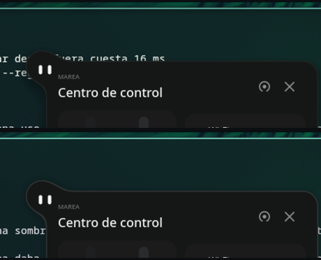

There was a black circle larger than her around her, and when the control
center opened, a dark stain above the panel stretching to the screen edge. It
was her shadow: black, blur 16, offset 7. **A black shadow over a desktop of
dark windows has nothing to darken**; all it does is dirty what is behind it.

Marea already dealt with this in its theme by reversing it: remove the shadow
and add a light halo, with no offset, hugging the outline. It was tested here
and **was not the answer**: white at 45% was a white shadow—the same problem in
another color—and mint at 22% was a green glow visible over any background
that was not black. A halo paints outside the silhouette, and anything painted
outside is visible.

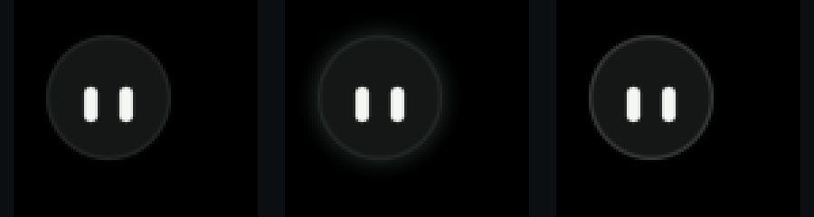

What was actually needed is what the halo was meant to cover: **against a truly
dark background, she disappears**. Her body is `#151616`, and against black
there is no visible difference (first frame). But nothing needs to be painted
outside for that: her `rim` is light **inside** the silhouette, and increasing
it from 6% to 14% (third frame) outlines her completely without touching a
single desktop pixel. The middle image is the halo, for comparison.

So the ball has neither a shadow nor a halo. A panel does have a shadow: it is
a 390 × 410 card floating over the windows and needs to communicate that it is
on top. And since **everything about a shadow is a calculation**, it appears
with the card and leaves with it:

```plm
let panel = clamp(max(card, tray) * 2, 0, 1)
shadow: 0, 2 * panel, 12 * panel, 32% * panel, #05070a
```

When `panel` is zero, there is no shadow to calculate: the renderer does not
even look at it.

## Sound: what plays and through which device

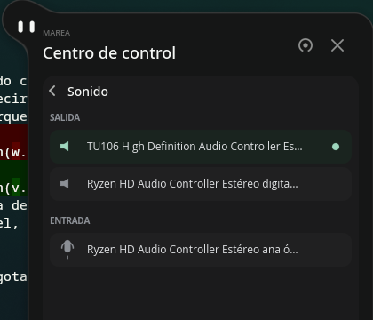

The control center had volume from the start—the slider on the left—but not
**where** sound comes out or **where** it comes in, which is what you look for
in a panel when plugging in headphones. Now it has another card: “Sound ·
Output and input,” with both lists, the selected device marked in mint, and one
click to change it.

And not one line needs to know about PipeWire. pleamar already provided volume;
what it lacked was **which devices are available**, so the `audio` service now
publishes `outputs` and `inputs`—from `wpctl status`—and `audio.default(id)`
changes the default. That is in pleamar and works for any scene; the list,
order, and names truncated to 42 characters are specific to this one.

| | |
| --- | --- |
| what is shown | “OUTPUT” with the available devices, then “INPUT” below it, positioned after the height of the output list (`card.top + 150 + lista_salidas.height`) rather than at a fixed location |
| how to choose | a click sends `elegir_aparato(i)`, and the logic calls `audio.default` with the PipeWire ID |
| verified | two outputs—the GPU's HDMI and the motherboard's digital output, with the selected one marked—and the analog input, as listed by `wpctl` |

## Session: a pause, a goodbye, and a separate confirmation

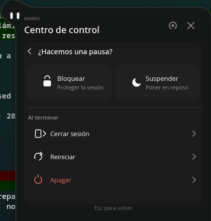

> “The hierarchy distinguishes two intentions: **take a break**—Lock and
> Suspend—and **end or start over**—Log out, Restart, and Power off, each with
> its explicit label.”
> “The coral accent distinguishes Power off; sage is for selection and focus,
> **not for disguising a destructive action**.”

It is the only action in the entire scene that cannot be undone, and therefore
the only one written twice: once on the card and once in the confirmation.
Lock and Suspend are issued directly—they are undone with a password or a
key—while the other three open a **separate** confirmation, not another step
on the same page but a different screen, with its own title, an explanation of
what will happen, and two visibly distinct buttons.

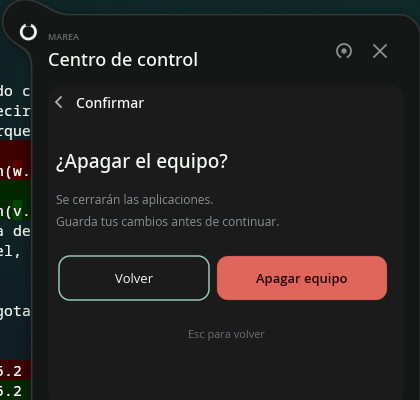

> “Back receives initial focus; the chosen action requires a **new, deliberate
> activation**, without reusing the click that opened the dialog or accepting
> an unintended repeat of Enter.”

That is not just nice wording: the button on the right lands exactly where the
row that opened the confirmation was, so a double-click would have confirmed
it by itself. That is why the action is **armed** only after a delay:
`on still confirma for 320ms` enables its zone, measured at **383 ms** after the
click. Back does not wait—it is the exit, and exits should never be delayed.

| | |
| --- | --- |
| list to confirmation | **201 ms** (the design specifies 200–240): one leaves to the left as the other enters from the right |
| arm the action | **383 ms** after clicking. Until then, the button on the right does not exist for the mouse |
| Esc | one returns to the list, another closes the page. Two rules with opposite guards; they do not conflict because `while` reads the previous frame |
| back (the arrow) | One step back means one step: from the confirmation, return to the list, not to the control center |
| change page | Disarms anything that was armed, as required by “do not leave a confirmation armed when changing options” |

### Her eyes, which become six symbols


> “Lock: one capsule forms the lock's shackle and the other its body.
> Suspend: the eyes narrow into two curved eyelids.
> Log out: one eye draws a door frame and the other an outgoing arrow.
> Restart: the two curved strokes join into a circular arrow.
> Power off: one eye forms the open ring and the other the vertical stroke.”

Five more links in the same face chain—the one that already included the
level, camera, dot, exclamation mark, Haven, sleep, and magnifying glass—and
not a single new geometry: a ring is a disk with its center eaten away by
another disk in the body color, and the lock's shackle is the same ring with
its lower half covered. The only separately drawn parts are the two arrowheads
and the door handle, because a triangle is not a bent capsule.

| | contract | measured |
| --- | --- | --- |
| the lock | 120–160 ms | **154 ms** |
| the eyelids | 140–180 ms | **152 ms** |
| the door | 180–240 ms | **188 ms** |
| the circular arrow | 300–400 ms rotation | **150 ms** for the morph, and **one full turn** of 350 ms each time it is highlighted |
| the power symbol | 140–180 ms | **150 ms** |
| the point of light | 200–300 ms | **239 ms** |


> “After confirmation, the symbol can contract to a small point of light and
> disappear.”

It is the only gesture in the whole scene that happens **after** a decision,
and the only one that cannot be seen to completion: when the system really
powers off, the compositor stops drawing halfway through the contraction. The
design already says “do not delay an operation or hold a fake screen open to
force the animation to finish,” so it does not wait. And since there is no way
for `sys.call` to respond, the opposite of pretending happens: **after four
seconds, if we are still here, her face returns** and the confirmation closes,
the most honest thing to do without knowing why nothing happened.

**Highlighting is not executing.** Hovering only previews what would happen:
`anticipa` is a different fact from `confirma`, and the lock on her face does
not certify that anything is locked. The commands belong to pleamar—
`session.lock`, `suspend`, `logout`, `reboot`, `poweroff`, implemented under
the hood with `loginctl` and `systemctl`—and the logic here has a second
safety belt so the whole gesture can be rehearsed without losing the machine:
with `MAREA_EN_PRUEBAS` set, it logs what it would do without doing it.
Everything measured on this page was captured that way, in a complete
sequence—row, confirmation, wait, click—that ended with
`session · testing: it would call session.poweroff` and nothing else.

## Settings: her home


There is no Codex design for this: this is the design. Three things, none of
them a form.

**Her home.** The two monitors are drawn as two **pools**—at quarter scale,
16:9, with their names above—and she swims inside the one she can see. Her home
pool is lit; clicking the other sends her there. And a third home, which is
neither: **“Follow me”** sends her to the monitor where you are working.

**Locking with networking**: whether the lock can also be opened with Esc. A
switch like the ones on the cards, and an honest note below: it lasts until
restart, because autostart sets the actual network.

**The background** is changed from her menu, under Customize, where it already
was.


### How she crosses from one monitor to another

A live layer-shell surface cannot move to another monitor, so there is **one
copy per monitor** (`screens: each max 2`), each with its own state, and the
logic decides which one is visible (`en.0`, `en.1`). Nothing switches off and
on: **nothing**. The copy that stops being hers exits on the side facing the
other monitor, and the one that becomes hers enters from that same side, using
the same 620 ms spring as exiting through the top edge; while traveling, she
sinks 4 px: the body does not move sideways; it slides. There is empty desktop
between the two surfaces, and it looks just as good as if she reached the
actual edge.

| | measured |
| --- | --- |
| logic switches her home | 16 ms |
| crossing (1% to 99%) | **300 ms** on each side, overlapping: 620 total |
| home is saved | by name (`DP-3`) in `ajustes.json`: monitors change number when another is connected, but not name |

**What I could not test:** “Follow me” with actual focus. Hyprland does not
move focus to another monitor while the mouse is still on this one, even with
`focuswindow`, and moving someone's mouse is not a valid test. It is verified
through the last link: the `window` service reports every change with the
focused monitor, and the logic decides based on it.

### What pleamar was missing

Four consecutive snags while repeating a 3,200-line scene across monitors, all
from the same family—the scene's own things were being looked up with the
copy's marker—and two new features: `screen.index` as a fact, so a standalone
`let` can have a different value in each copy, and `window.monitor`.

## What the language was missing, and no longer is

Twenty-two, all fixed in pleamar instead of being worked around here:

1. **There was no way to verify a duration.** Polling externally costs 16 ms
   per read, a full frame. Now there is `--registrar`.
2. **`blink` counted the period from when the eye opened**, so “every 5.2 s”
   came out as 5.33. It now counts from start to start and accepts a single
   period.
3. **There was no way to specify durations.** The contract is in milliseconds,
   while pleamar only had springs, which arrive when they arrive. A spring can
   now be specified by time: **`~620ms`** means it arrives in that time without
   bouncing. Measured: 619 ms.
4. **Ambient behavior overrode gestures.** Breathing has its own blink, and
   the idle blink could land on top of it: two blinks in a second and a half.
   Now a gesture takes precedence, and the ambient timer freezes while it runs.
5. **A shadow that did not fit was clipped without warning.** The renderer now
   reports it once the calculation stops growing.
6. **An impulse could not depend on anything.** `impulse` only accepted a
   literal number, but the contract calls for a bounce that **decreases** with
   the countdown. It now accepts an expression evaluated when triggered:
   `impulse pop left * 2.5`.
7. **`every … while x` counted down while `x` was false**, so the countdown
   took its first step after 300 ms—the remainder of the previous timer. The
   timer now resets completely while the condition is false.
8. **A rule could not see what another rule had just done.** All rules are
   checked before anything is applied, so `on change` sees it on the next
   frame; when nothing moves, “next” was the next scheduled wake-up:
   **one second later**. The countdown became a red dot one second after its
   last number. An effect now guarantees one more frame: 17 ms.
9. **There was no sine or cosine**, so nothing could travel along an arc. Now
   there are `sin(deg)` and `cos(deg)`.
10. **The renderer stopped for 300 ms halfway through an animation** (above,
   under “What this exposed”).
11. **A surface could not wait for what it contained.** `open:` only accepted a
   fact; it now accepts a condition: `open: tuck > 0.01`.
12. **A standalone `clip` also clipped the other window**, and nothing was
   visible without any warning. It took an hour to find. Open clips now end
   where a named surface begins.
13. **There was no way to say “when this has stayed unchanged for a while.”**
   The contract requires it in three places—the level stays for 1.1 s after
   the last change, the time note has 300 ms of grace, and the notification
   700 ms—and pleamar only had `on change`, its inverse. With that, a burst
   of keystrokes looked like a series of blinks. Now there is
   **`on still x for 1.1s`**: every change resets the timer to zero, so a burst
   reads as a continuous stream, and the action fires once when it ends.
   Measured: 1,102 ms after the last change, without spending a frame waiting.
14. **Autonomous animations kept going with reduced motion.**
   `--movimiento-reducido` settled springs and froze gestures, but `blink`,
   `wave`, and `spin` continued looping—the very things that should not keep
   spinning. Now the eye stays open, the wave stays halfway through its
   journey, and the spin stays where it was. Measured: the tide stays at
   0.0000 across all 32 frames over five seconds; there are 32 because it
   sleeps when nothing is moving.
15. **The emergency exit took right-click away from scenes that used it.**
   It closed the program while no scene used the button, and as soon as a
   scene did, it disappeared completely: either have a menu or be able to
   close the prototype. The renderer now decides, since it checks the zones:
   if the click did not land on any zone, close. Over her, her menu appears;
   two finger-widths away, it closes.

16. **A shadow could only be black, and its values were fixed.** A black shadow
   over dark windows has nothing to darken: it looks like a dirty ring around
   what it was supposed to separate from the background. `shadow` now takes a
   color, and **all its properties are expressions**. With one set of numbers,
   you had to choose between what a little ball needs and what a 390 × 410
   panel needs, even though both are the same body. Now the shadow appears
   with the card and goes away with it (`32% * panel`), and when the value is
   zero the renderer does not even inspect it. Color uses the three slots
   `color1` already had free, so it costs no extra bytes per element.

17. **An SVG could only be used as a stamp.** Rasterized in an atlas, it is
   visible, but it cannot merge with anything, be tinted by part, animate by
   layer, or scale without becoming pixels. Now there is `figure`: the same
   file read as paths, by layer, using `usvg` that was already included for
   images. It is watched like a library: draw the hat, save, and it is there.
18. **A property declared twice silently swallowed the first one**, keeping
   only the last. Here, that meant two `services:` lines in the same
   `permissions` block—one per topic, which seemed tidier—but only the lower
   one counted: audio lost its permission, and the failure appeared three
   layers later as an empty list. It is now an error where it is written.
19. **A property's spring was ignored when assigning a value.**
   `prop candado = 0 ~150ms` followed by `candado: 1` moved with `lively`
   (250 ms) because the transition used the default spring when no other was
   specified. The reference already promised otherwise. Measurement showed
   it: five face morphs declared at 150, 160, 170, 180, and 200 ms all took
   the same 235 ms. Now each takes its own duration, and the prototype does
   not have to repeat in every rule what was already declared.
20. **Hidden things still caught the mouse.** A child in a layout with `show:`
   disabled its zones; a `group { show: … }` did not, despite the reference
   promising otherwise. Here, that left two control center cards unopenable—
   the ones immediately below the sound list rows, whose list was closed but
   still in front—and made it look as if the card did nothing. It is the
   hidden counterpart to the usual rule: **the click belongs to the last
   declared zone**.
21. **Content clipped against the edge was not reported.** A surface does not
   grow to fit its contents, so adding two cards to the control center left it
   abruptly clipped 36 px at the bottom—and this had happened before. The
   shadow warning did not catch it: it only checks sides where the shape
   floats inside the surface, and a clipped shape does not float there. It now
   checks the shape too, with two safeguards to avoid noise: only when it
   **almost fits entirely**—her neck intentionally hangs off the top edge—
   and never at an edge to which the surface is attached. Since this scene is
   always breathing and never settles, it does not wait for rest: after three
   seconds clipped, it reports it.
22. **`--registrar` did not say which names exist.** A nonexistent name was
   recorded as `?` for the entire measurement. Names inside a component copy
   include their marker (`px#Apoyado2`), which cannot be guessed: it now
   reports them at startup, along with similar names.

## What comes next

There is nothing major left to do in the ball's contract: the full Swell, Haven,
sleep, control center—with sound and session controls—, her menu, and wardrobe
are implemented and measured. What comes next is another chapter:

- **Real notifications**, which are currently a made-up sequence. pleamar
  knows how to fetch them; it still needs permission, and we need to decide
  what happens when Marea already owns the notification slot.
- **System activity** (`Actualiza`, `Trabaja`): the rotating amber ring,
  orbiting marks, and the two “up to date” checkmarks. It introduces `spin`
  and, more importantly, calls for moving the face to `layer`, the refactor
  that would best organize the file.
- **Search preview:** design 02 shows the selected document with its contents
  beside it. That requires reading the file, which belongs to the logic, and
  deciding what to show for a video or image.
- **Opening an actual file:** today an application launches, while a file is
  only written to the log. `xdg-open` is missing; it is one line and one
  decision.
- **Getting a response from the system.** `sys.call` sends a request and never
  returns, so the session cannot distinguish “shutting down” from “the system
  blocked it”: all it has is a four-second timeout and a returning face. The
  design asks to show the reason, which would require a command that can
  respond.
